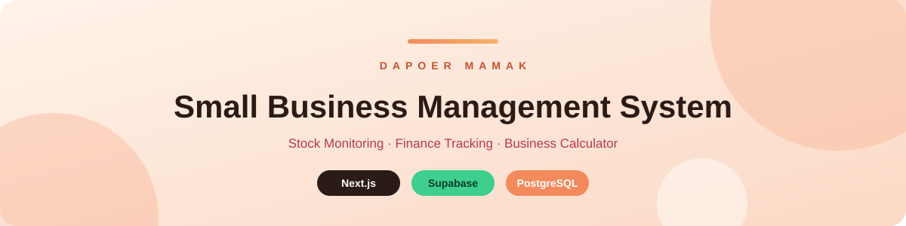
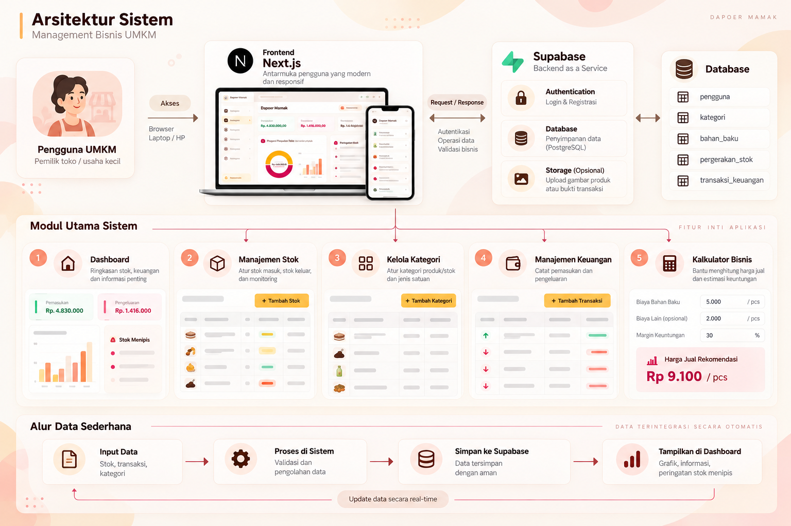

<div align="center">



<br/>


[](https://dapur-mamak.vercel.app/)

**[Overview](#-overview) · [Modules](#-main-modules) · [Data Flow](#-simple-data-flow) · [Architecture](#-system-architecture) · [Getting Started](#-getting-started)**

</div>

---

## 🍰 Overview

A management web app for small businesses such as cake shops and similar food businesses. It replaces manual record keeping with a simple system for **monitoring ingredient stock** and **tracking daily finances**.

This is a **client project** built for a small business owner who had trouble with record keeping and business management.

> [!NOTE]
> **The problem:** the owner could not easily tell how much stock was left, whether items were running low, whether the business made a profit or a loss today, and how much the net profit was.

**The solution:** one dashboard where the owner records stock and transactions, sees the numbers in charts and cards, and gets a warning before ingredients run out.

> [!IMPORTANT]
> **Scope:** the system only manages **raw material stock** and **money in and out**, with monitoring and low-stock warnings. It does not cover the production process or finished-product stock.

---

## ✨ Main Modules

<table>
  <tr>
    <td width="33%" valign="top">
      <h3>1️⃣ Dashboard</h3>
      Overview of stock, finance, and key information with charts and info cards. A <b>low-stock warning card</b> alerts the owner when ingredients are running out.
    </td>
    <td width="33%" valign="top">
      <h3>2️⃣ Inventory Management</h3>
      Manage incoming and outgoing raw material stock with full CRUD: add stock, reduce stock, and monitor what is left.
    </td>
    <td width="33%" valign="top">
      <h3>3️⃣ Category Management</h3>
      Manage categories for stock and transactions, so every raw material has a clear name, unit type, and category.
    </td>
  </tr>
  <tr>
    <td width="33%" valign="top">
      <h3>4️⃣ Finance Management</h3>
      Records all income and expenses so the owner can see whether the business is profitable today.
    </td>
    <td width="33%" valign="top">
      <h3>5️⃣ Business Calculator</h3>
      Helps decide the selling price and check the expected profit before pricing a product.
    </td>
    <td width="33%" valign="top">
      <h3>🔐 Authentication</h3>
      Users register or log in with Supabase Auth, then go straight to their dashboard. The app has a single user role.
    </td>
  </tr>
</table>

### 📏 Unit types
Raw materials come in many units, so they are grouped into three types to keep stock tidy:

| Type | Units |
|---|---|
| ⚖️ **Weight** | gram, kg |
| 🧪 **Volume** | ml, liter |
| 📦 **Unit** | pcs, box, can, bottle, and others |

### 💰 How finance works
- **Income:** the owner enters the day's sales transactions, and the finance total increases right away.
- **Expenses from stock:** every stock addition automatically creates an expense, so finance decreases without extra input.
- **Other expenses:** the owner can also add manual expenses that are not related to stock.

---

## 🔄 Simple Data Flow

| 1. Input data | → | 2. Process | → | 3. Store | → | 4. Display |
|:-:|:-:|:-:|:-:|:-:|:-:|:-:|
| Stock, transactions, categories | | Data validation and processing | | Stored in Supabase | | Graphs, key information, low-stock alerts |

Data is integrated automatically, so every update shows up in real time.

---

## 🏗️ System Architecture

| Layer | Technology | Role |
|---|---|---|
| Frontend | **Next.js** | Modern, responsive interface for browser and mobile |
| Backend as a Service | **Supabase** | Authentication, database, and optional file storage |
| Database | **PostgreSQL** (Supabase) | Data storage |

The frontend sends requests to Supabase for authentication, data operations, business logic, and validation.

<details>
<summary><b>🗄️ Database tables</b></summary>

<br/>

| Table | Purpose |
|---|---|
| `users` | Registered users |
| `categories` | Categories for stock and transactions |
| `raw_materials` | Raw material data (name, unit type, category) |
| `stock_movements` | Incoming and outgoing stock records |
| `financial_transactions` | Income and expense records |

</details>

<div align="center">
  
</div>

---

## 🚀 Getting Started

### Prerequisites
- Node.js 18+ and npm
- A free [Supabase](https://supabase.com/) project

### Installation
```bash
git clone https://github.com/DoriFransDika/Management-Bisnis.git
cd Management-Bisnis
npm install
```

### Environment variables
Create a `.env.local` file in the project root and fill in the values from your Supabase project settings:

```env
NEXT_PUBLIC_SUPABASE_URL=your-project-url
NEXT_PUBLIC_SUPABASE_ANON_KEY=your-anon-key
```

> Use the variable names that this repository actually reads. Never commit `.env.local` or any real keys.

### Run
```bash
npm run dev
```
Then open [http://localhost:3000](http://localhost:3000).

---

## 👤 Author

<div align="center">

**Dori Frans Dika**
Informatics Engineering graduate, Institut Teknologi Padang

[LinkedIn](https://linkedin.com/in/dori-frans-dika) · [GitHub](https://github.com/DoriFransDika) · [Portfolio](https://my-portfolio-alpha-nine-51.vercel.app/) · dorifransdikaa@gmail.com

</div>
